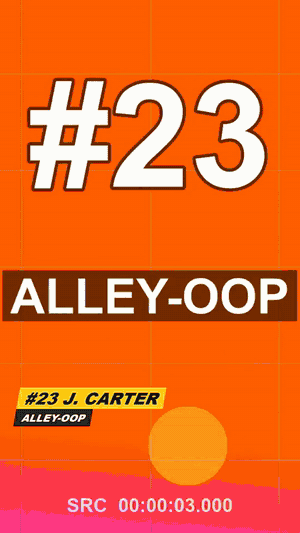

# beat-highlight-demo

Give it a folder of clips and a song, and it edits a 30-second highlight video for you. Every cut lands on the beat, the best play hits the drop in slow motion, and the finished file is checked automatically before it's handed back.



The clips in this repo are placeholders made with FFmpeg (coloured cards with a player name), so the repo ships without any copyrighted footage or music. Point it at real game footage and a real track and the same code produces a real mixtape.

## What it does

1. Reads a short list of your clips: which player, what happened, how important it was.
2. Finds the tempo, the beats and the drop in the song.
3. Orders the clips like an editor would: a good play to open, rising energy, the best play on the drop, a strong closer.
4. Renders the video with Remotion: titles, player name cards, flashes and zooms on the beat. Vertical, square or landscape.
5. Checks the output with FFmpeg: right length, no black frames, audio in sync, loudness at -14 LUFS (the level YouTube and TikTok normalise to). If a check fails, it says so and stops.

The same input always gives the same video, so nothing has to be fixed by hand.

## Run it

You need Node 20.11 or newer and FFmpeg installed.

```bash
npm install
npm run samples                                  # makes the placeholder clips and a 120 BPM track
npm run make -- --manifest input/manifest.json   # renders out/highlight-vertical.mp4
npm test                                         # 77 tests
```

Other formats and looks:

```bash
npm run make -- --manifest input/manifest.json --format square
npm run make -- --manifest input/manifest.json --style recruiting --format landscape
```

## Using your own footage

List your clips in a JSON file like this, then run `npm run make` with it:

```json
{
  "title": "RIVERSIDE HAWKS",
  "subtitle": "2026 Season Highlights",
  "style": "hype",
  "format": "vertical",
  "targetDuration": 30,
  "music": "media/track.mp3",
  "clips": [
    { "id": "dunk-23", "file": "footage/game4_q3.mp4", "player": "#23 J. Carter",
      "event": "dunk", "importance": 5, "inPoint": 12.4, "outPoint": 18.9 }
  ]
}
```

`inPoint` and `outPoint` mark the usable part of each clip, in seconds. Only use footage and music you have the rights to.

## Built with

TypeScript, Remotion, FFmpeg, zod and Vitest. The beat detection is written from scratch, with no audio library.

How each step works, the test list and known limitations are in [docs/HOW-IT-WORKS.md](docs/HOW-IT-WORKS.md).

## License

MIT. Remotion has its own license: free for individuals and companies with up to 3 employees, paid for larger companies. See <https://remotion.dev/license>.
