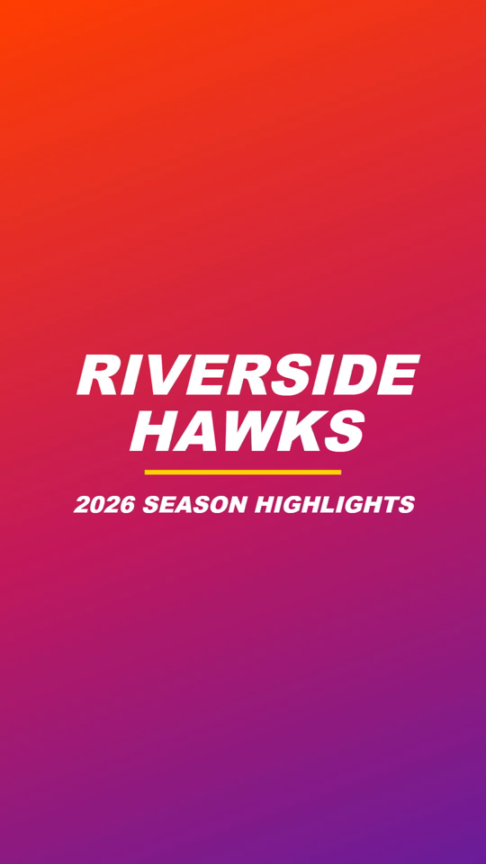
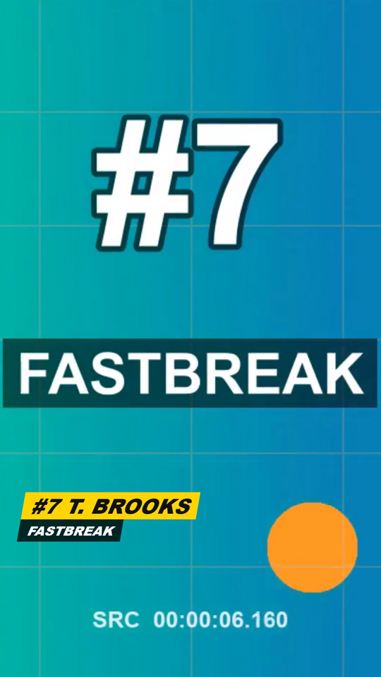
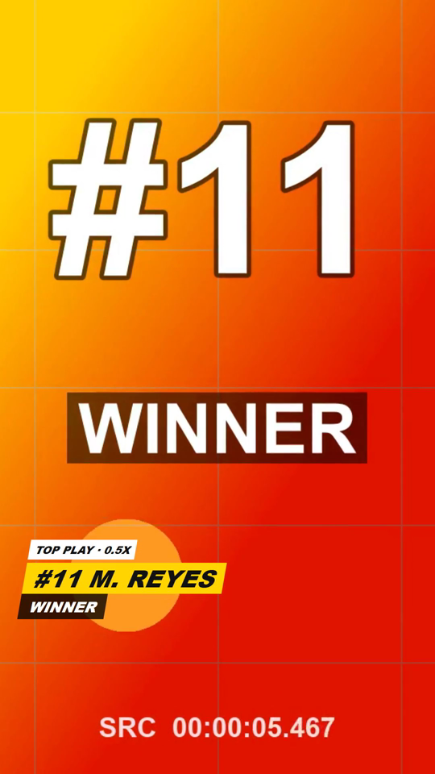

# beat-highlight-demo

**Beat-synced sports highlight generator.** Hand it a list of clips with player/event/importance tags and a music track, and it renders a finished 30-second mixtape. Every cut lands on a beat, the best play hits the drop, and the output passes automated QA before it's done.

It's a small, deterministic, fully tested **programmatic video pipeline**:

```
structured input → probe/normalise → beat analysis → timeline solver → Remotion render → automated QA
```

The same input always produces the same video, frame for frame. Nothing is edited by hand, and no code is written per video.

| Intro card | Build (beat-cut) | Top play on the drop (0.5x slow-mo) |
|---|---|---|
|  |  |  |

*All sample media is synthetic and generated with ffmpeg (no copyrighted footage or music). The burned-in `SRC` timecode shows exactly which part of each source clip the solver picked.*

---

## Architecture

```mermaid
flowchart LR
    A["input/manifest.json<br/>clips + music + style + format"] -->|zod| B[Validate]
    B --> C["Probe (ffprobe)<br/>Normalise (ffmpeg)<br/>CFR 30fps H.264 mezzanine<br/>2-pass loudnorm -14 LUFS"]
    C --> D["Beat analysis (pure TS)<br/>spectral flux → tempo → beat grid<br/>downbeats → energy → drops"]
    D --> BM[(beatmap.json)]
    BM --> E{{"Editorial planner<br/>(rule-based default,<br/>optional LLM)"}}
    E -->|"plan JSON<br/>(schema + semantic validation)"| F["Timeline solver (pure)<br/>beat snapping · duration allocation<br/>clip bounds · downbeat alignment"]
    F --> RM[(render-manifest.json<br/>versioned)]
    RM --> G["Remotion composition<br/>100% manifest-driven"]
    G --> H[highlight-format.mp4]
    H --> I["Automated QA<br/>ffprobe · blackdetect · ebur128"]
    I --> Q[(qa-report.json)]
    I -->|violation| X[exit code 2]
```



## Pipeline stages

| # | Stage | Code | What it guarantees |
|---|---|---|---|
| 1 | **Input** | `src/schema/input-manifest.ts` | A zod schema with strict keys (typos are errors), safe clip ids, `outPoint > inPoint`, unique ids, and 3 to 60 clips. Every problem is reported at once, with a JSON path. |
| 2 | **Probe / normalise** | `src/media/` | ffprobe reads duration, fps, resolution and codec. Clips that aren't already H.264/yuv420p/30fps are transcoded to a CFR 30fps mezzanine (short GOP, so seeking is fast); compliant clips are stream-copied. Music goes through a two-pass **linear loudnorm** to -14 LUFS plus a safety limiter, then to WAV (AAC priming delay would shift the beat grid). Results are cached by content key. |
| 3 | **Beat analysis** | `src/beat/` | Pure functions over PCM: STFT (in-house radix-2 FFT) → log-magnitude **spectral flux** → **autocorrelation** tempo with a log-normal prior → a joint **period/phase grid fit** → **downbeats** every 4 beats → an RMS **energy curve** → **drops** (a loudness jump in dB weighted by absolute loudness). Writes `beatmap.json`. |
| 4 | **Planner + timeline solver** | `src/planner/`, `src/solver/` | The planner decides the story. The solver does the math: it takes the strongest drop that fits, sets a frame-quantised music offset so that drop lands about 55% of the way in, water-fills beats across shots, slows footage down if it's too short, drops the weakest clips if there are too many, moves importance-5 plays onto downbeats, and converts to frames without drift. `assertInvariants` then checks the result (no gaps or overlaps, outro ends the video, every shot inside its footage) before it writes a versioned `render-manifest.json`. |
| 5 | **Render** | `src/remotion/`, `src/render/` | A single `Highlight` composition. Components: `Clip` (OffthreadVideo with `trimBefore` + `playbackRate`, beat/downbeat zoom pulse), `PlayerLowerThird` (placed in the social safe area), intro/outro `TitleCard`, and `BeatFlash` (flash on every cut, bigger on drops). The theme is `hype` (bold, italic, strong flashes and zooms) or `recruiting` (clean, subtle). Format is set by props. |
| 6 | **Automated QA** | `src/qa/` | Duration within ±0.5s of the target, video stream within ±2 frames of the manifest frame count, audio/video length within 0.1s (A/V sync), resolution, fps, an audio stream, **no black segments** (`blackdetect`), **integrated loudness** of -14 ±2 LUFS and **true peak** at or below -1 dBTP (`ebur128`). Writes `qa-report.json`. **Any violation exits with code 2.** |
| 7 | **CLI** | `src/cli/make.ts` | `npm run make -- --manifest input/manifest.json` runs all of the above. |

### Story rules (rule-based planner)

| Role | Pick | Why |
|---|---|---|
| **Opener** | 3rd-strongest play | Hooks the viewer without spending the best material |
| **Build** | Weaker plays, importance **ascending** | Energy rises into the drop |
| **Top** | Strongest play (importance → footage length → id) | Lands exactly on the **biggest drop**, in 0.5x slow-mo for `hype` |
| **After drop** | The remaining strong plays | Keeps the energy up |
| **Closer** | 2nd-strongest play | The last thing a coach or fan remembers |

The "strongest play" sort is deterministic. Clips that don't fit the shot budget are dropped, weakest first, and listed in `warnings`.

## Why an AI/LLM plugs in at stage 4, and only there

Choosing *which plays tell the best story* is editorial judgement. That's a good fit for an LLM: it can read scouting notes, box scores or a coach's brief ("emphasise defence, she's a PG prospect"). Beat math, frame counts and clip bounds are **not** a good fit for an LLM, so the design keeps the two apart:

```ts
// src/planner/editorial-planner.ts
export interface EditorialPlanner {
  readonly name: string;
  plan(input: PlannerInput): Promise<unknown>;   // unknown on purpose: never trusted
}
```

- `RuleBasedPlanner` (the default) needs no API key and no network, and is fully deterministic.
- An LLM planner would implement the same interface and return JSON. The pipeline runs it through `EditorialPlanSchema` (zod, strict) **and** `validatePlan`: every id must exist, no clip can be used twice, and every clip must be accounted for. A hallucinated clip id or a malformed plan is **rejected before the solver runs** (see the `rejects an invalid editorial plan` test).
- Whatever the planner returns, the solver still enforces the hard constraints (beats, duration, bounds). The LLM can make the edit *better*. It can't make the video *broken*.

## Run it

Requirements: **Node >= 20.11** (uses `import.meta.dirname`) and **ffmpeg + ffprobe** on `PATH`. Tested with Node 22.20 and ffmpeg 8.0.1 on Windows 11.

```bash
npm install
npm run samples                                    # synthetic clips + 120 BPM track + input/manifest.json
npm test                                           # 77 vitest tests
npm run make -- --manifest input/manifest.json     # full pipeline -> out/highlight-vertical.mp4
```

Options:

```bash
npm run make -- --manifest input/manifest.json --format square
npm run make -- --manifest input/manifest.json --style recruiting --format landscape --out out/recruiting
npm run make -- --manifest input/manifest.json --skip-render   # stop after the solver (fast iteration)
```

The first render downloads Remotion's headless Chrome (about 110 MB, one time only).

Outputs in `out/`: `highlight-<format>.mp4`, `beatmap.json`, `editorial-plan.json`, `render-manifest.json` and `qa-report.json` (which includes stage timings). The manifest and report files describe the latest run, so use `--out` to keep runs separate.

## Example output (sample media, `hype`, `vertical`)

Beat analysis: **119.98 BPM** (the track is 120), 81 beats, drop detected at **16.00s** (it was synthesised at 16.0s).

| Video time | Length | Role | Clip | Imp. | Speed | On downbeat |
|---|---|---|---|---|---|---|
| 0.0s | 2.0s | intro card | | | | yes |
| 2.0s | 4.0s | opener | alleyoop-23 | 5 | 1x | yes |
| 6.0s | 2.0s | build | layup-5 | 2 | 1x | yes |
| 8.0s | 2.0s | build | fastbreak-7 | 2 | 1x | yes |
| 10.0s | 3.0s | build | steal-7 | 3 | 1x | yes |
| 13.0s | 3.0s | build | assist-3 | 3 | 1x | (beat) |
| **16.0s** | 4.0s | **top (drop)** | **winner-11** | 5 | **0.5x** | yes |
| 20.0s | 2.0s | after drop | crossover-11 | 3 | 1x | yes |
| 22.0s | 2.0s | after drop | block-34 | 4 | 1x | yes |
| 24.0s | 2.0s | after drop | three-11 | 4 | 1x | yes |
| 26.0s | 2.0s | closer | dunk-23 | 5 | 1x | yes |
| 28.0s | 2.0s | outro card | | | | yes |

QA report ([`docs/example-qa-report.json`](example-qa-report.json)): all 9 checks pass. Duration is 30.06s (the video stream is exactly 900 frames), 1080x1920 at 30fps, A/V within 0.06s, no black segments, **-14.1 LUFS** integrated, **-1.6 dBTP** true peak. Render time is about 70s on a laptop CPU for 900 frames, and the file is 16.4 MB. The full manifest is at [`docs/example-render-manifest.json`](example-render-manifest.json).

QA isn't just for show. On the first run the gate **failed** at a true peak of -0.5 dBTP, because the AAC encoder overshot the transient-heavy kick drum. The fix was to add true-peak headroom and a limiter at normalisation time, and the gate now passes. That's exactly the kind of regression it exists to catch.

## Swapping in real footage and music

1. Put your clips anywhere and list them in a manifest. Paths are resolved relative to the manifest file, and absolute paths work too:

   ```json
   {
     "title": "RIVERSIDE HAWKS",
     "subtitle": "2026 Season Highlights",
     "style": "hype",
     "format": "vertical",
     "targetDuration": 30,
     "music": "media/track.mp3",
     "clips": [
       { "id": "dunk-23", "file": "footage/game4_q3.mp4", "player": "#23 J. Carter",
         "event": "dunk", "importance": 5, "inPoint": 12.4, "outPoint": 18.9 }
     ]
   }
   ```

2. `inPoint`/`outPoint` bound the usable range. The solver end-aligns each shot within it, so **end the range just after the payoff** (ball through the net).
3. Any container or codec ffmpeg can read works: VFR phone footage, 60fps, 25fps and so on. Audio from the clips is discarded; the music is the soundtrack.
4. Music works best with a steady tempo (most produced hip-hop and EDM). The analyser assumes a constant tempo; see the limitations below.
5. **Only use media you have rights to.** Licensed music is the main legal risk for sports mixtape platforms.

## Tests

```
tests/beat.test.ts      FFT, tempo at 100/120/128/140 BPM (±3), beat placement < 30 ms, drop → downbeat,
                        silence error, ffmpeg integration: the synthetic 120 BPM track → 120 ±3 BPM, drop ≈ 16 s
tests/solver.test.ts    cuts on beats, no gaps, duration ±0.5 s, clip bounds incl. slow-mo, top play on the drop,
                        importance-5 on downbeats, story arc, determinism, recruiting rules, too many clips,
                        too little footage (clear error), slow-mo stretch, music too short, no drop, late drop,
                        95 BPM, invalid LLM plan rejected, planner prefers more plays over slow-mo, allocator
tests/review-fixes.test.ts  regressions from code review: unusable-clip dropping, frame-quantised music start
                        (120/128/95 BPM), VFR detection, frame-accurate + A/V QA, manifest invariants, drop fallback
tests/manifest.test.ts  valid/sample manifests, 10 invalid cases with path-qualified messages, plan validation
tests/qa.test.ts        ebur128 / blackdetect / loudnorm / ffprobe parsers, QA pass + each failure mode, beat-fx helpers
```

## Known limitations

- **Constant tempo assumed.** The beat grid is one global period and phase fit. Live-drummed or tempo-changing music would need a dynamic-programming beat tracker (e.g. Ellis 2007) in `src/beat/tempo.ts`.
- **Downbeats are heuristic.** The strongest drop defines bar phase; otherwise the low-band (kick) accent does. Real downbeat detection is a harder problem.
- **No "moment of impact" field.** Shots are end-aligned in `[inPoint, outPoint]`. A `peakTime` per clip would let the solver land the dunk exactly *on* the drop instead of the drop starting the shot.
- **Uniform stretch.** When footage is short, one short clip slows the whole region to 0.85x or 0.7x instead of using a per-clip rate.
- **Slow-mo is frame-doubled.** 0.5x on 30fps footage repeats frames. Real highlight footage should be shot at 60/120fps, or frames interpolated (`minterpolate`) during normalisation.
- **Trusted manifests only.** Media paths can be absolute or contain `..`, so a manifest can point ffmpeg at any local file. `ffmpeg` has no timeout, stdout is fully buffered, and music length is uncapped. Before accepting manifests from untrusted users (e.g. a web upload), add path containment, timeouts and size limits.
- **Error codes and messages.** "Target duration too short for the arc" currently reports `MUSIC_TOO_SHORT`, and an `inPoint` past the clip end reports as a generic "usable range shorter than 0.5s".
- **Readonly typing.** Parsed and solved objects are frozen at the boundaries (manifest, probe), but several exported results (`allocateBeats`, `layoutSlots`, `analyzePcm`, `solveTimeline`) are typed as mutable rather than `readonly`.
- Render uses system fonts (Arial Black / Segoe UI), so it never needs network access. Looks vary slightly on Linux without those fonts.
- Beat analysis library: none. It's hand-written TypeScript, with no third-party DSP dependency or license to track. (MIT options such as `music-tempo` exist, but only return tempo and beats, not drops or energy.)

## License

- This project: **MIT** (see `LICENSE`).
- **Remotion is not MIT.** It is free for individuals and for **companies with up to 3 employees**. Larger companies need a paid Remotion company license. See <https://remotion.dev/license>.
- Other runtime dependencies: React (MIT), zod (MIT). ffmpeg is invoked as an external binary.
